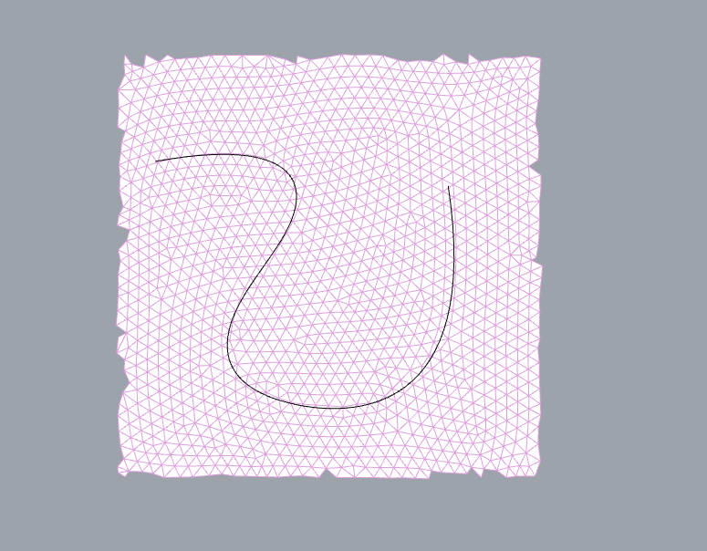
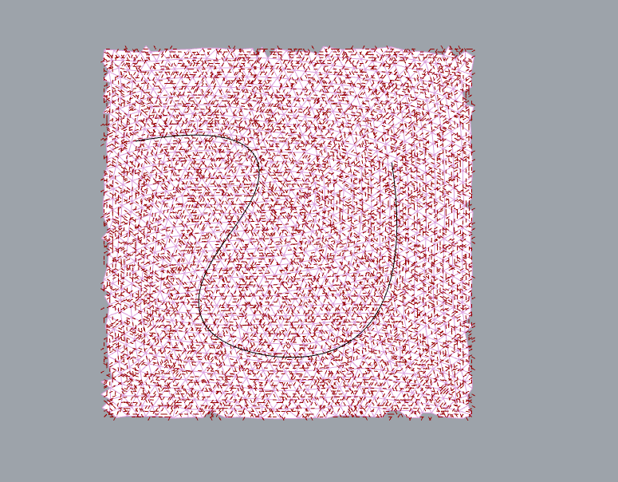
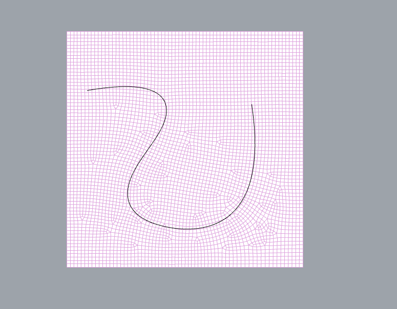

<p align="center">
  
</p>

# Instant Mesh+

Instant Mesh+ is a Rhino 8 / Grasshopper wrapper around
[wjakob/instant-meshes](https://github.com/wjakob/instant-meshes) that exposes
the solver's orientation and position fields instead of treating remeshing as
a black box.

The v0.1 workflow is:

1. Author field constraints from Grasshopper points, vectors, and curves.
2. Configure the Instant Meshes field symmetry and extraction settings.
3. Solve through a cancellable native worker process, asynchronously by
   default or synchronously when selected from the solver's component menu.
4. Receive the remesh, full field samples, detected singularities, warnings,
   timings, and lightweight Grasshopper previews.

## Example results

A guided solve shown from the input triangle mesh through field optimization
to the extracted quad mesh.

| Input mesh and guide curve | Optimized orientation field | Extracted quad mesh |
| :---: | :---: | :---: |
|  |  |  |

## Components

| Component | Purpose |
| --- | --- |
| **Instant Mesh Settings** | Target by faces, vertices, or model-unit edge length; set RoSy/PoSy, intrinsic/extrinsic mode, feature behavior, extraction, and reproducibility. |
| **Orientation Constraint** | Project a point and preferred tangent vector to the surface orientation field. |
| **Position Constraint** | Project a point and anchor to the surface position field. |
| **Field Curve Guide** | Approximate a curve within a model-unit deviation tolerance, then use it as an orientation guide or a combined orientation and edge-path guide. |
| **Move Singularity** | Detect the nearest existing singularity and request movement along a projected curve. |
| **IM Solver** | Run the worker asynchronously by default, or uncheck **Solve asynchronously** in the component menu for a synchronous UI-thread solve. The selected mode is saved with the Grasshopper definition. |

Constraint weights range from 0 to 1. Multiple constraints at the same region
are blended after symmetry-compatible alignment. Points are projected to the
nearest input triangle and distributed to its vertices with barycentric
weights. Set a nonzero projection tolerance when guide geometry should be
strictly rejected beyond a known model-space distance.

Singularity paths do **not** prescribe an exact singularity charge or create a
new singularity. In this release they move a detected existing singularity and
are supported for the upstream 4-RoSy / 4-PoSy edit operations.

## Exposed Instant Meshes functionality

Available now:

- face-count, vertex-count, and edge-length targets;
- 2-, 4-, and 6-RoSy orientation fields;
- quad (4-PoSy) and triangular (6-PoSy) position fields;
- intrinsic and extrinsic optimization;
- open-boundary alignment and crease-angle feature normals;
- pure and dominant tri/quad extraction;
- smoothing plus surface reprojection;
- deterministic mode and explicit worker thread count;
- orientation and position field output;
- detected orientation and position singularities;
- point/vector, point/anchor, and sampled-curve constraints;
- detected-singularity movement paths;
- phase timing, constraint acceptance counts, warnings, eager async
  cancellation, visible progress, and timeout isolation.

Good follow-on features supported by the upstream codebase but not yet exposed:

- oriented point-cloud input and configurable k-nearest-neighbor adjacency;
- staged solve controls (preprocess, orientation, position, extraction) and
  reusable solver snapshots;
- interactive field brushing and local re-optimization;
- import/export of upstream application-state snapshots;
- compatibility-oriented export modes and richer mixed-face cleanup controls;
- explicit crease/boundary curve sets rather than angle-only feature
  detection;
- research toward exact prescribed singularity index/charge creation, which
  requires solver changes rather than a thin wrapper.

## Repository setup

Requirements:

- Rhino 8;
- CMake 3.25 or newer;
- .NET 8 SDK;
- on Windows x64, Visual Studio 2022 with Desktop development with C++;
- on macOS 12.4 or newer, Xcode Command Line Tools. Both Apple Silicon and
  Intel Macs are supported through one universal worker.

Clone with submodules:

```powershell
git clone --recursive https://github.com/anthonychukh/InstantMeshPlus.git
Set-Location InstantMeshPlus
```

If the repository was cloned without them:

```powershell
git submodule update --init --recursive
```

Build and test on Windows:

```powershell
.\scripts\build.ps1 -Configuration Debug
```

Build and test on macOS:

```bash
bash scripts/build-macos.sh Debug
```

The Grasshopper load directory on both platforms is:

```text
src/InstantMeshPlus.Grasshopper/bin/Debug/net8.0
```

That directory contains `InstantMeshPlus.Grasshopper.gha`,
`InstantMeshPlus.Core.dll`, and the platform-native worker plus oneTBB runtime:
`InstantMeshPlus.Worker.exe` / `tbb12.dll` on Windows, or
`InstantMeshPlus.Worker` / `libtbb.12.dylib` on macOS. The committed Visual
Studio launch profile binds this current output through
`RHINO_PACKAGE_DIRS`, starts Rhino MCP, and opens Grasshopper. It does not copy
development files into `%APPDATA%\Grasshopper\Libraries`.

For a manual Rhino launch:

```powershell
$env:RHINO_PACKAGE_DIRS = (Resolve-Path .\src\InstantMeshPlus.Grasshopper\bin\Debug\net8.0).Path
& 'C:\Program Files\Rhino 8\System\Rhino.exe' /nosplash /netcore '/runscript="! _mcpstart _Enter _Grasshopper"'
```

For macOS build details and first-run notes, see
[docs/MACOS.md](docs/MACOS.md).

## Packaging

For each release, first increment `<VersionPrefix>` in
[`Directory.Build.props`](Directory.Build.props) using a three-part semantic
version such as `0.1.3`. This is the authoritative version for the compiled
assemblies and Yak package; the packaging script rejects a different
`-Version`, and any `release_vX.Y.Z` tag must match it exactly.

Create the platform package on its matching operating system with Rhino 8's
installed Yak CLI or McNeel's standalone Yak 0.13.0 executable:

```powershell
.\scripts\Build-YakPackage.ps1 -Version 0.1.3 -Platform win
./scripts/Build-YakPackage.ps1 -Version 0.1.3 -Platform mac
```

The results are
`instantmeshplus-<version>-rh8_32-win.yak` and
`instantmeshplus-<version>-rh8_32-mac.yak` under the matching
`artifacts/yak/<platform>` directory. The Rhino floor is inferred from the
project's RhinoCommon 8.32 reference. Each archive contains the common managed
payload plus only its own native worker and oneTBB runtime, with no debug
symbols.

Three GitHub Actions workflows are configured. Only the non-publishing build
workflow runs on normal branch pushes:

- **Build and validate** runs for branch pushes and pull requests. It builds
  both packages, executes the universal Mac worker on Apple Silicon and Intel
  runners, validates the exact two-archive set, and uploads artifacts. It does
  not publish.
- **Test Yak package** is manual. It consumes the same validated pair, pushes
  both to McNeel's test server, and confirms the exact version by search. The
  test server is an external write and is cleared nightly.
- **Release Yak package** runs only when a tag matching `release_vX.Y.Z` is
  pushed. It requires an exact tag/version match, a commit contained in
  `main`, an unused GitHub release tag, and an unpublished public Yak version.
  It creates a draft GitHub release containing both archives before the Yak
  pushes and publishes that release only after the public Yak search confirms
  the version.

The workflows use the pinned standalone Yak 0.13.0 downloads documented by
McNeel. The manual workflow expects `YAK_TOKEN` in a `yak-test` environment;
the public workflow expects it in a protected `yak-production` environment.
Generate the CI token locally with `yak login --ci`, then store only its value
in the environment secret; never commit or print it. Restrict
`yak-production` to the `main` branch and `release_v*.*.*` tags, and add a
required reviewer if public publication should require human approval.

Apple certification is not required for building, testing, or producing an
unsigned Mac Yak package. Developer ID signing and notarization are optional
release hardening. When desired, set `ENABLE_MACOS_SIGNING=true` and configure
the six Apple secrets documented in [docs/MACOS.md](docs/MACOS.md). Leaving
that variable absent or false keeps Apple credentials out of the critical
build and release path.

After the manual test workflow succeeds and the intended release commit is on
`main`, the public trigger format is:

```powershell
git tag release_v0.1.3
git push origin release_v0.1.3
```

Do not push the tag until a public release is intended. See
[the protocol specification](docs/PROTOCOL.md) and
[architecture notes](docs/ARCHITECTURE.md) for extension points.

## License

Instant Mesh+ is MIT licensed. Instant Meshes is BSD-licensed, JSON for Modern
C++ is MIT-licensed, and GrasshopperAsyncComponent is Apache-2.0-licensed. See
[THIRD_PARTY_NOTICES.md](THIRD_PARTY_NOTICES.md) and the license files retained
in each pinned submodule.
